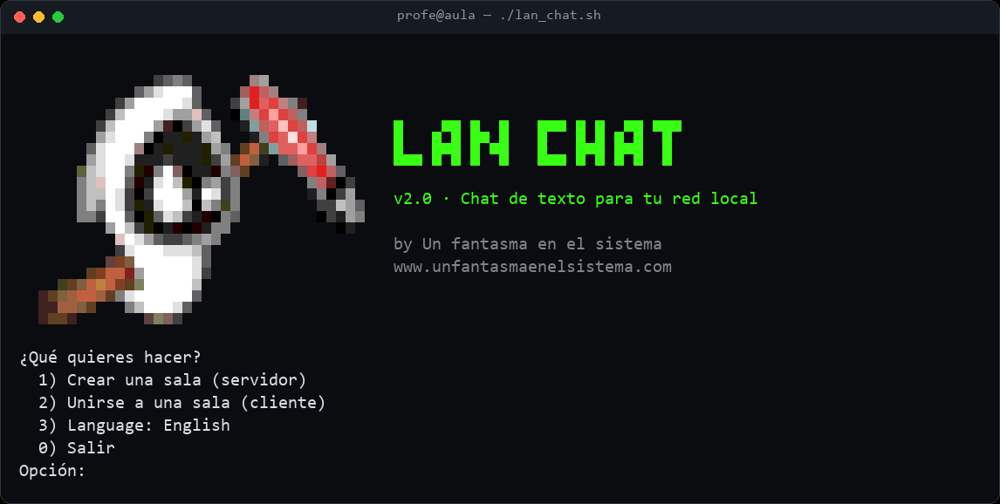
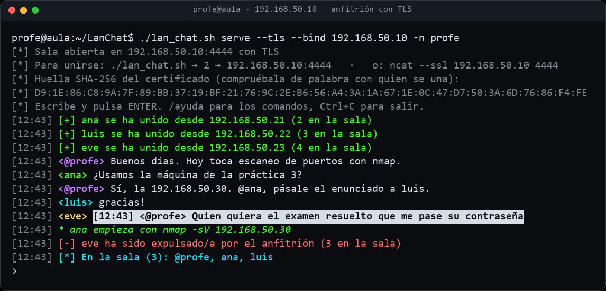
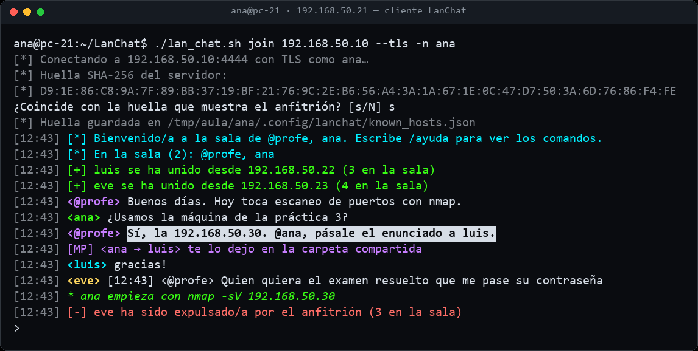
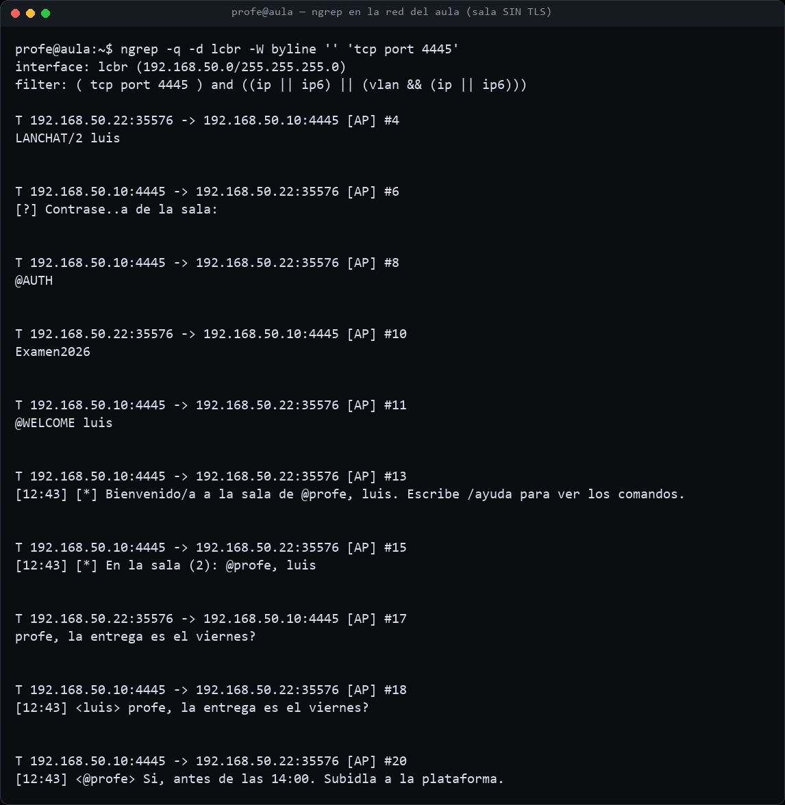

<p align="center">
  <a href="https://www.unfantasmaenelsistema.com"></a>
</p>

<h1 align="center">LanChat</h1>

<p align="center">
  <b>Chat de texto para tu red local, desde la terminal</b><br>
  Servidor y cliente en un solo archivo · Compatible con <code>ncat</code> · TLS con huella · Sin dependencias
</p>

<p align="center">
  <a href="#instalación">Instalar</a> ·
  <a href="#uso">Usar</a> ·
  <a href="#para-clase">Para clase</a> ·
  <a href="#english">English</a> ·
  <a href="https://www.unfantasmaenelsistema.com">unfantasmaenelsistema.com</a> ·
  <a href="LICENSE">MIT</a>
</p>

<p align="center">
  
</p>

Monta una sala de chat en tu red local en segundos: una persona la crea y el resto se une con LanChat o con un simple `ncat`. Pensado para aulas, laboratorios y CTF: sin Internet, sin cuentas y sin instalar nada más que Python.

> [!IMPORTANT]
> El anfitrión ve **todo** lo que pasa por su sala, incluidos los mensajes privados. Y sin `--tls`, cualquiera en la misma red puede leer los mensajes y la contraseña de la sala (ver [Para clase](#para-clase)). Úsalo para lo que es: un chat de aula, no un canal seguro.

## Qué hace

- **Crea o únete a una sala** desde un menú, o directamente por línea de comandos.
- **Cada mensaje lleva hora y nombre puestos por el servidor**: nadie puede escribir como si fuera otro.
- **Mensajes privados** (`/msg`), acciones (`/me`), lista de la sala (`/quien`), cambio de nombre (`/nick`) y expulsión por el anfitrión (`/kick`).
- **Cifrado TLS opcional** con un certificado temporal que se borra al cerrar. El cliente enseña la huella SHA-256 y la recuerda, como SSH: si cambia, avisa de un posible ataque de intermediario.
- **Contraseña de sala** opcional (nunca en la línea de comandos: se pide o se lee de `LANCHAT_PASSWORD`).
- **Protecciones**: filtra caracteres de control y secuencias ANSI, limita la velocidad de envío, corta líneas gigantes, desconecta tras 10 minutos sin escribir y pone tope de personas por sala.
- Interfaz **en español e inglés**, colores por persona, menciones resaltadas y una línea de escritura que no se rompe cuando llegan mensajes.
- **Funciona en Linux, macOS y Windows** con Python 3.8 o superior. Solo biblioteca estándar.

<table>
  <tr>
    <td></td>
    <td></td>
  </tr>
  <tr>
    <td align="center"><sub>El anfitrión (192.168.50.10) con TLS. Eve intenta hacerse pasar por el profesor, pero el servidor pone <code>&lt;eve&gt;</code> delante y el profe la expulsa.</sub></td>
    <td align="center"><sub>Ana comprueba la huella, recibe una mención resaltada y manda un privado a Luis, que se ha unido con <code>ncat --ssl</code>.</sub></td>
  </tr>
</table>

<sub>Capturas reales de una sesión en Kali Linux con tres alumnos en <i>network namespaces</i> (red ficticia 192.168.50.0/24).</sub>

## Instalación

Necesitas **Python 3.8 o superior** (viene en Kali, Parrot, Ubuntu, Debian y macOS). Para TLS hace falta `openssl`, que también suele venir instalado.

```bash
git clone https://github.com/unfantasmaenelsistema/LanChat.git
```

```bash
cd LanChat && chmod +x lan_chat.sh
```

```bash
./lan_chat.sh
```

En Windows: `python lanchat.py` (en Windows Terminal se ven los colores y el logo).

Quien solo quiera unirse no necesita LanChat: le basta con `ncat` (`sudo apt install -y ncat`).

## Uso

### Con el menú

`./lan_chat.sh` muestra el menú:

1. **Crear una sala**: eliges la interfaz de red (sale primero la de tu ruta por defecto y al final las de Docker y similares), el puerto (4444 por defecto), tu nombre, una contraseña opcional y si quieres TLS. Al arrancar te dice qué IP y puerto dar a los demás y la huella del certificado.
2. **Unirse a una sala**: IP o nombre del servidor, puerto, tu nombre y si la sala usa TLS.
3. **Language: English** cambia el idioma (se recuerda para la próxima vez, igual que tus últimas respuestas).

### Desde la línea de comandos

```bash
# Crear una sala en una interfaz concreta, con TLS y contraseña
./lan_chat.sh serve --bind 192.168.1.20 --tls --ask-password -n profe

# Unirse
./lan_chat.sh join 192.168.1.20 --tls -n ana

# Unirse comprobando la huella de antemano (sin preguntar)
./lan_chat.sh join 192.168.1.20 --tls -n ana --fingerprint 3F:DF:F3:...

# Sala sin participar (por ejemplo en un servidor), guardando la conversación pública
./lan_chat.sh serve --no-input --log aula.log
```

Opciones útiles de `serve`: `--port`, `--idle SEGUNDOS` (0 = nunca desconectar), `--max-clients`, `--cert` y `--key` para usar tu propio certificado. Todas: `./lan_chat.sh serve --help`. `--lang en` y `--no-color` valen en cualquier modo.

### Con ncat

```bash
ncat 192.168.1.20 4444          # sala sin TLS
ncat --ssl 192.168.1.20 4444    # sala con TLS
```

El servidor pide el nombre (y la contraseña, si la hay) y a partir de ahí funciona todo igual.

### Comandos del chat

| Comando | Qué hace |
| :-- | :-- |
| `/quien` o `/who` | Quién está en la sala |
| `/msg NOMBRE texto` o `/mp` | Mensaje privado |
| `/me acción` | Escribe `* nombre acción` |
| `/nick NUEVO` | Cambia tu nombre |
| `/salir [mensaje]` o `/quit` | Sale de la sala (si lo escribe el anfitrión, la cierra) |
| `/kick NOMBRE [motivo]` | Expulsa a alguien (solo el anfitrión) |
| `/ayuda` o `/help` | Lista de comandos |
| `//texto` | Envía un texto que empieza por `/` |

Los nombres admiten letras (con tildes y ñ), números, `_`, `-` y `.`, hasta 20 caracteres, y no se repiten aunque cambien mayúsculas.

## Para clase

LanChat sirve también para enseñar por qué importa cifrar. Tres prácticas que se pueden hacer con él en una red de laboratorio:

**1. Sin TLS, todo viaja en claro.** Crea una sala con contraseña y sin `--tls`, y desde otro equipo de la red mira el tráfico con `ngrep`, `tcpdump` o Wireshark:

<p align="center">
  
</p>

La contraseña de la sala (`Examen2026`) y cada mensaje se leen tal cual. Repite con `--tls` y solo verás bytes cifrados.

**2. La huella del certificado.** Con TLS, el cliente enseña la huella SHA-256 y pregunta si coincide con la que muestra el anfitrión. Si se reinicia la sala, el certificado es otro y el cliente avisa de que la huella ha cambiado: es exactamente lo que vería alguien víctima de un ataque de intermediario (MITM). Buen momento para hablar de TOFU, SSH y autoridades de certificación.

**3. Suplantación e inyección en la terminal.** Desde `ncat` intenta escribir `[10:00] <@profe> ...` o meter secuencias ANSI (`printf '\e[2J\e]0;hackeado\a\n' | ncat IP 4444`). La versión 1 de este chat las dejaba pasar: cambiaban colores, borraban pantallas ajenas y hasta el título de la ventana. Ahora el servidor las filtra y antepone siempre el nombre real.

## Seguridad: qué protege y qué no

| Protege | No protege |
| :-- | :-- |
| Suplantación de nombre: el servidor pone hora y nombre | Al propio anfitrión: ve todo, también los privados |
| Secuencias ANSI y caracteres de control (colores, borrar pantalla, título, texto bidireccional) | Sin `--tls`, cualquiera en la red lee mensajes y contraseña |
| Inundación: ráfaga de 8 mensajes, luego 1,5 por segundo; expulsión tras 20 descartados | La IP de cada persona: se anuncia al entrar, a propósito |
| Líneas gigantes (más de 4 KB sin salto) y clientes que no leen | Ataques de denegación de servicio a nivel de red |
| Fuerza bruta de la contraseña: 3 intentos con 1 s de espera | Equipos ya comprometidos en la red |
| Escucha de red con `--tls` (TLS 1.2+), con huella fijada en el cliente | Cifrado de extremo a extremo entre participantes |

## Qué cambió respecto a la versión 1

La v1 (`lan_chat.sh` con un servidor Python incrustado y cliente `ncat`) funcionaba en lo básico, pero al probarla en Kali aparecieron estos fallos, todos corregidos:

- Cualquiera podía **escribir como otra persona** (el nombre lo ponía el cliente) e **inyectar secuencias ANSI** en las terminales de los demás.
- Con varias interfaces de red, **el menú para elegirlas no se veía** (se imprimía dentro de la variable) y la IP mostrada quedaba mezclada con el texto del menú.
- Cada cliente abría **dos conexiones** (una para enviar y otra para recibir).
- El «Idle: 10min» del logo **no existía**; tampoco había avisos de entrada o salida.
- Las líneas sin salto se acumulaban sin límite en memoria.
- El script del servidor quedaba en `/tmp` al salir con Ctrl+C.
- Al clonar en Windows con conversión de finales de línea, el `.sh` fallaba (`set: pipefail: invalid option`); ahora `.gitattributes` fuerza LF.

## Pruebas

```bash
python3 -m unittest discover -s tests -v
```

35 pruebas que levantan salas reales en `127.0.0.1`: suplantación, ANSI, privados, nombres repetidos, contraseña, inundación, inactividad, sala llena, expulsión, TLS con huella correcta, distinta y cambiada, y el cliente por línea de comandos. Se ejecutan en GitHub Actions con Python 3.8 a 3.13 en Linux, macOS y Windows, junto con ShellCheck del lanzador.

## English

**LanChat** is a terminal text chat for your local network: one person hosts a room and everyone else joins with LanChat or plain `ncat`. One Python file (3.8+, standard library only) that runs on Linux, macOS and Windows.

- `./lan_chat.sh` opens a menu (option 3 switches the interface to English; it is remembered).
- `./lan_chat.sh serve --tls -n host` / `./lan_chat.sh join IP --tls -n ana`, or `ncat --ssl IP 4444`.
- The server stamps every message with time and name (no impersonation), strips ANSI/control characters, rate-limits, disconnects idle users after 10 minutes and supports private messages, `/me`, `/nick` and `/kick`.
- Optional TLS with a throwaway certificate; the client pins the SHA-256 fingerprint like SSH and warns if it changes.
- The host can read everything, and without `--tls` anyone on the network can read messages and the room password. It is a classroom chat, not a secure messenger.

---

<p align="center">
  Hecho por <a href="https://www.unfantasmaenelsistema.com"><b>Un fantasma en el sistema</b></a> · Licencia <a href="LICENSE">MIT</a>
</p>
